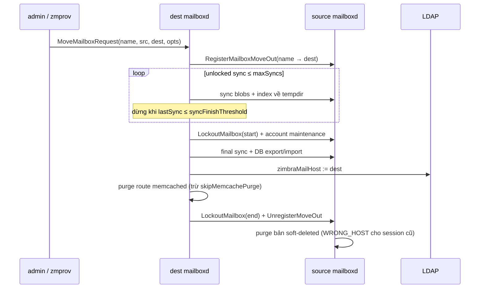

# Giải pháp move mailbox ZCS NETWORK 10.1.0 — dựng lại từ contract + hook FOSS

> Nguồn bundle: `D:/project/zcs-NETWORK-10.1.0_GA_4688.RHEL9/`
> (installer NETWORK 10.1.0 GA 4688 RHEL9 + RPM bung sẵn + source FOSS đối chiếu `D:/project/zmsrc/repos/zm-mailbox`).
> Code thực thi move là enterprise closed-source, **không có trong bundle** — tài liệu này dựng lại từ
> contract công khai (SOAP/LDAP) + hook FOSS hai đầu. Mọi suy đoán ngoài chứng cứ đều gắn `[INFERENCE]`.

## 1. Kết luận vị trí implementation

- Bung `extracted_rpms/zimbra-network-store-10.1.0.1721127242-1.r9.x86_64.rpm` → chỉ 4 file,
  trong đó `opt/zimbra/lib/ext/network/zimbranetwork.jar` (152 KB).
- Liệt kê toàn bộ entries của `zimbranetwork.jar` (qua `ZipFile API`):
  chỉ có `SMIME`, `HAB`, `AddressList`, `CrossMailboxSearch`,
  `NetworkAccountService`, `NetworkAdminService`, `NetworkInitializer`, `SearchMultipleMailboxes` —
  **không có class `MoveMailbox` nào**.
- `strings NetworkAdminService.class` xác nhận chỉ đăng ký handler
  SMIME/HAB/AddressList/SearchMultipleMailboxes, không có `MoveMailboxRequest`.
- `rg MoveMailbox` toàn bộ `zmsrc/repos/zm-mailbox/store/src/java` chỉ trúng:
  `ProvUtil.java` (unregister), `ZAttr*` (config), `LockoutMailbox.java`,
  `MailboxManager.java` (comment) — **không có handler**.
- Suy ra: logic export/import DB + sync blob nằm trong gói mailboxd enterprise
  (không ship trong tarball add-on này). Bundle chỉ cho ta **contract + hook**.

## 2. Contract SOAP — toàn bộ là `@zm-api-command-network-edition`

| SOAP | File contract | Vai trò |
|---|---|---|
| `MoveMailboxRequest/Response` | `zmsrc/repos/zm-mailbox/soap/src/java/com/zimbra/soap/admin/message/MoveMailboxRequest.java` | Gửi **tới dest server**, kèm `src` + `dest` làm safety check |
| `RegisterMailboxMoveOutRequest/Response` | `soap/.../admin/message/RegisterMailboxMoveOutRequest.java` + `admin/type/MailboxMoveSpec.java` (`{name, target}`) | Đăng ký move-out phía source |
| `UnregisterMailboxMoveOutRequest/Response` | `soap/.../admin/message/UnregisterMailboxMoveOutRequest.java`; dùng tại `store/.../cs/account/ProvUtil.java:1749` | Gỡ đăng ký (cleanup / move lỗi) |
| `QueryMailboxMoveRequest/Response` | `soap/.../admin/message/QueryMailboxMove*.java` → `admin/type/MailboxMoveInfo.java` (`{name, start, type in/out, source, target, noPeer}`) | Liệt kê move in/out đang chạy, opt `checkPeer=1` hỏi peer |
| `LockoutMailbox` (FOSS) | `store/src/java/com/zimbra/cs/service/admin/LockoutMailbox.java` | `op=start/end`, quiesce mailbox phía source |

Enum hướng move: `soap/src/java/com/zimbra/soap/type/MailboxMoveType.java` — `out | in`.
Hằng wire: `common/src/java/com/zimbra/common/soap/BackupConstants.java:42-58,81-98,147,182-192`.

### Tham số `MoveMailboxInfo`

Nguồn: `soap/src/java/com/zimbra/soap/admin/type/MoveMailboxInfo.java:29-185`.

| Attr | Default | Ý nghĩa |
|---|---|---|
| `name` | required | Account email |
| `target` (`dest`) | required | Hostname dest = server nhận request |
| `source` (`src`) | required | Hostname source = `mailHost` hiện tại |
| `blobs` | `config` | `include / exclude / config` — blob thường |
| `secondaryBlobs` | `config` | `include / exclude / config` — blob secondary/HSM (chỉ có nghĩa khi `blobs` không bị exclude) |
| `searchIndex` | `config` | `include / exclude / config` — index |
| `maxSyncs` | `10` | Số vòng sync tối đa khi account còn unlocked |
| `syncFinishThreshold` | `180000` ms (code; doc ghi `30000`) | Ngưỡng dừng pha unlocked: vòng sync cuối ≤ ngưỡng |
| `sync` | false | `1` = chạy đồng bộ, chờ tới khi xong |
| `ngMigration` | — | Flag migration NG (không có tài liệu kèm trong bundle) |
| `skipRemoteLockout` | false | Bỏ lockout mailbox phía remote — tương thích ngược server legacy |
| `skipMemcachePurge` | false | Bỏ purge route memcached — khi proxy/memcache xử lý ngoài |

## 3. Luồng end-to-end

### Pha 1 — Safety check

`src` phải bằng `mailHost` hiện tại của account, `dest` phải là server nhận request
(javadoc `MoveMailboxRequest.java:36-40`). Sai → từ chối trước khi copy.

### Pha 2 — Unlocked sync

Lặp copy blob + index về dest staging dir trong khi account vẫn mở.
Dừng khi lặp đủ `maxSyncs` **hoặc** vòng sync cuối ≤ `syncFinishThreshold`
(javadoc `MoveMailboxRequest.java:44-47`).
Staging dir: `zimbraMailboxMoveTempDir`, default `/opt/zimbra/backup/tmp/mboxmove`
(`store/conf/attrs/zimbra-attrs.xml:5548-5551`).

### Pha 3 — Quiesce

`LockoutMailbox op=start` → `MailboxManager.lockoutMailbox(accountId)`
(`store/.../cs/mailbox/MailboxManager.java:975-981`) =
`beginMaintenance` + ghi `maintenanceLocks` map; account chuyển `maintenance`
(mẫu `ProvUtil.doUnlockMailbox:1738-1744`).
Cơ chế lock: `maintenanceLocks: ConcurrentHashMap<accountId, MailboxMaintenance>`
(`MailboxManager.java:80,632-658,984-1017`).

### Pha 4 — Final sync + DB move

Một vòng sync cuối sau lock, rồi export/import MySQL mailbox sang dest.
`[INFERENCE]` Thứ tự export redo-log/MySQL/fsync không suy ra được từ bundle —
cần jar mailboxd enterprise hoặc DB dump để khóa.

### Pha 5 — Chuyển home + purge route

Đổi LDAP `zimbraMailHost` sang dest; purge route proxy/memcached
(trừ khi `skipMemcachePurge=1` cho môi trường proxy xử lý ngoài).
Session cũ còn bám bản source: `MailboxManager.getMailboxById:487-496` ép
`WRONG_HOST(account.getMailHost())` — buộc client reconnect sang host mới.

### Pha 6 — Cleanup

`UnregisterMailboxMoveOut` + `LockoutMailbox op=end`
(`ProvUtil.java:1746-1779`, có `finally` gỡ lock + trả account về `active`).
Move thất bại → cleanup task chạy lại theo
`zimbraMailboxMoveFailedCleanupTaskInterval`, default `20m`
(`zimbra-attrs.xml:9200-9204`, `ZAttrConfig.java:35280-35396`).

## 4. Cấu hình LDAP điều khiển move

Nguồn: `store/conf/attrs/zimbra-attrs.xml`.

| Attr | ID / dòng | Default | Ý nghĩa |
|---|---|---|---|
| `zimbraMailboxMoveSkipSearchIndex` | #1006 / :4613 | FALSE | Bỏ search index, build lại sau |
| `zimbraMailboxMoveSkipBlobs` | #1007 / :4618 | FALSE | Bỏ blob thường |
| `zimbraMailboxMoveSkipHsmBlobs` | #1008 / :4623 | FALSE | Bỏ blob secondary/HSM |
| `zimbraMailboxMoveTempDir` | #1175 / :5548 | `/opt/zimbra/backup/tmp/mboxmove` | Staging phía dest |
| `zimbraMailboxMoveFailedCleanupTaskInterval` | #2079 / :9200 | `20m` | Lịch chạy lại cleanup move lỗi |

Giá trị per-request `blobs / secondaryBlobs / searchIndex = include|exclude|config`:
`config` = theo 3 attr trên (`MoveMailboxInfo.java:52-80`).

## 5. Quyền admin

- `LockoutMailbox.checkRights` đòi `moveMailboxFromServer` trên server
  (`LockoutMailbox.java:40-45`).
- `docRights`: `moveAccountMailbox` (account thường) /
  `moveCalendarResourceMailbox` (calendar resource) + `moveMailboxFromServer`
  (`LockoutMailbox.java:82-93`).
- Hằng quyền: `moveMailboxFromServer`, `moveMailboxToServer`
  (`store/.../cs/account/accesscontrol/generated/RightConsts.java:1395-1400`).

## 6. Ghi chú S3 / cloud-native (từ handover)

- `zcs-NETWORK/zcs-handover/SPEC-FORK-CLOUD-NATIVE.md:57`: với S3 centralized,
  move nhanh vì **không copy blob**, chỉ chuyển DB + metadata.
- `zcs-NETWORK/zcs-handover/SPEC-ZCS-OSE-SOLUTION.md:182,220`:
  `zmmboxmove` **chưa được thử** trên fork OSE/S3 — rủi ro blob mồ côi,
  cần ma trận kiểm thử + job đối soát. Không có binary `zmmboxmove` trong bundle này.

## 7. Gaps, rủi ro, bước tiếp theo

1. `[INFERENCE]` Chi tiết pha locked (export MySQL lúc nào, redo-log, retry idempotent)
   chưa khóa được — cần `zimbra-store.jar` (`com.zimbra.cs.backup.*`) từ host NETWORK đang chạy.
2. `skipRemoteLockout=1` chỉ ghi "tương thích ngược server legacy" — chưa rõ version floor an toàn.
3. Flag `ngMigration` có trong contract nhưng không có tài liệu kèm.
   → `zmove` từ chối explicit (`--ng-migration` báo lỗi thay vì lặng lẽ bỏ qua).
4. Không có test/repro move trong repo này.
5. Vận hành đề xuất: lấy jar mailboxd enterprise → decompile pha locked;
   dump `zimbra-attrs.xml` + `zmprov gs` để chốt `SkipBlobs/HsmBlobs/SearchIndex/TempDir`;
   lab thử `MoveMailbox(sync=1)`, giám sát `QueryMailboxMove(checkPeer=1)` + `mailbox.log`,
   rồi đối soát blob (S3 centralized vs volume local).

## 7b. zmove divergence (NE behavior trên vs những gì `zmove/` thực thi)

| NE (tài liệu trên) | zmove thực thi | Lý do |
|---|---|---|
| `Register/Unregister/QueryMailboxMove` server-side registry | SQLite journal local (`state.py` partial UNIQUE) + `query_moves()` best-effort warn ở preflight | Không có handler NE; không ship server code |
| Staging `zimbraMailboxMoveTempDir/.../mboxmove` | Ghi thẳng `Volume.mailbox_dir(dst_id)` + schema `zmove_stage_<job>`; merge 1 txn mới INSERT `zimbra.mailbox` nên mailboxd chưa serve dir trước merge | Giảm 1 lần copy; an toàn nhờ reserve-id |
| Full DB export *while locked* | Delta prestage online (`mod_metadata/content > W`), final delta dưới lock, fallback full-copy + `COUNT+BIT_XOR(MD5)` verify | Giảm lock-time; giả thiết watermark trong `dbmove.py` |
| Blob copy + inventory NE | rsync converge `maxSyncs/threshold` + `--checksum` vòng final + so `(count,bytes)`; external/S3 volumes skip copy, chỉ remap `locator` (cần `shared_volumes` explicit) | S3 centralized: không copy bytes |
| Cleanup task `FailedCleanupTaskInterval=20m` | `gc` thủ công (`--older-than`, default 24h) dọn stage + blob dirs; cron/systemd timer do operator đặt | Không có server-side scheduler |
| `sync=1` đồng bộ / `verify_tls` | `--sync` no-op (luôn đồng bộ); `verify_tls` + `--cacert` thật (mặc định `-k`) | Tương thích tên, không giả vờ semantics |

## 7c. Port `zmmboxmove` sang Python (`compat_mboxmove.py`, `soap.move_mailbox`)
> `zmove mboxmove -a <email> -f <src> -t <dst>` hoặc `python -m zmove.compat_mboxmove`
> (prog `zmmboxmove`). Thin client gửi `MoveMailboxRequest` tới dest — không tự
> copy dữ liệu như `zmove move`.
| Java (`MboxMoveUtil`) | Python port | Ghi chú |
|---|---|---|
| `LicenseAdaptor.check(BACKUP_ENABLED)` | Bỏ hẳn — server tự enforce, client gate sẽ fail-closed oan trên FOSS | Cố ý lệch Java để tránh chặn sai |
| `Provisioning.get(ServerBy)` + `hasMailClientService` | `zmprov -l gs` + `has_mail_client` (`topology.py`) | Message lỗi giữ nguyên văn NE |
| `account{name,src,dest,sync,skipRemoteLockout,ngMigration}` (`--force`→`skipRemoteLockout`) | `AdminSoap.move_mailbox()` — JSON bool, đã verify live: `already-on-this-server` (XML) và `NO_SUCH_ACCOUNT` (JSON), đều dừng trước mutation | `sync`→in `Mailbox move completed successfully`, ngược lại `started`; exit 0/1 |
| `--authtoken/--authtokenfile` (JSON), `-s` (bị `--to` override) | Hỗ trợ tương đương; `-s` vẫn bị override như Java | Không port interactive prompt của `SoapCLI.auth()` |

## 7d. Port tác vụ server NE sang Python (`ne_server.py`, `zmove ne-move`)
> `NeServerMove` chạy đúng thứ tự `handleNetworkRequest/moveIt`: checks →
> `RegisterMailboxMoveOut` → unlocked rsync rounds → lock → final sync → full
> DB copy *while locked* → cutover → purge cache → unregister. Không journal,
> không resume (như `MailboxMoveThread`).
| NE (`MoveMailbox.java`) | Python port | Ghi chú |
|---|---|---|
| `DEFAULT_MAX_SYNCS=10`, `DEFAULT_SYNC_FINISH_THRESHOLD=180000` | Hằng cùng tên, default từ `opts` → settings | Đã sửa settings theo code (không theo doc 30s) |
| `getRemoteVersionInfo` (mbox/db/index) | So `version/db_version/index_version` 2 đầu | Lệch là dừng trước mutation |
| `ALREADY_EXISTS → Purge it with zmpurgeoldmbox first` | Giữ nguyên message, không có `--overwrite` như engine | Fail-closed đúng NE |
| `downloadAndExtractZip` + `blobs-sync-token` | Bytes đi bằng rsync volume (đường đã chứng minh của zmove); điều kiện dừng vòng và skip flags giữ nguyên | End-state giống hệt, khác cơ chế vận chuyển |
| `copyDatabase` full export/import while locked | `DbMove.final("full")` + `compare` + `merge` 1 txn | Merge nguyên tử hơn import thẳng vào live của NE |
| Live orphan-blob sweep, tempdir cleanup | Chỉ dọn stage/tempdir; **bỏ** sweep live (sai locator math sẽ xóa nhầm dữ liệu) | Gap parity đã ghi nhận |
| `MailboxMoveThread` async | `run(sync=False)` thread non-daemon; CLI `ne-move` luôn sync | Control node thoát là thread chết nên không async thật |
| `FailedCleanupTaskInterval` dọn move lỗi | Best-effort unregister + unlock trong `finally` | An toàn hơn NE, không chờ 20m |
| `Register/UnregisterMailboxMoveOut` | `ALREADY_BEING_MOVED_OUT` vẫn abort; `UNKNOWN_DOCUMENT` (FOSS) → warn + chạy tiếp không registry | Port nhắm FOSS nên không đòi handler NE |

## 8. Tài liệu tham chiếu

- `zmsrc/repos/zm-mailbox/soap/src/java/com/zimbra/soap/admin/message/MoveMailboxRequest.java`
- `zmsrc/repos/zm-mailbox/soap/src/java/com/zimbra/soap/admin/type/MoveMailboxInfo.java:29-185`
- `zmsrc/repos/zm-mailbox/soap/src/java/com/zimbra/soap/admin/type/MailboxMoveSpec.java`
- `zmsrc/repos/zm-mailbox/soap/src/java/com/zimbra/soap/admin/type/MailboxMoveInfo.java`
- `zmsrc/repos/zm-mailbox/soap/src/java/com/zimbra/soap/type/MailboxMoveType.java`
- `zmsrc/repos/zm-mailbox/soap/src/java/com/zimbra/soap/admin/message/{Query,Register,Unregister}MailboxMove*.java`
- `zmsrc/repos/zm-mailbox/common/src/java/com/zimbra/common/soap/BackupConstants.java:42-58,81-98,147,182-192`
- `zmsrc/repos/zm-mailbox/store/src/java/com/zimbra/cs/service/admin/LockoutMailbox.java`
- `zmsrc/repos/zm-mailbox/store/src/java/com/zimbra/cs/mailbox/MailboxManager.java:80,460-541,632-658,975-1017`
- `zmsrc/repos/zm-mailbox/store/src/java/com/zimbra/cs/account/ProvUtil.java:1704-1782`
- `zmsrc/repos/zm-mailbox/store/conf/attrs/zimbra-attrs.xml:4613-4626,5548-5551,9200-9204`
- `zcs-NETWORK-10.1.0_GA_4688.RHEL9/extracted_rpms/zimbra-network-store-10.1.0.1721127242-1.r9.x86_64.rpm`
  → `work/netstore-cpio/opt/zimbra/lib/ext/network/zimbranetwork.jar` (đã liệt kê entries, không chứa MoveMailbox)
- `zcs-NETWORK/zcs-handover/SPEC-FORK-CLOUD-NATIVE.md:57`,
  `zcs-NETWORK/zcs-handover/SPEC-ZCS-OSE-SOLUTION.md:182,220`
