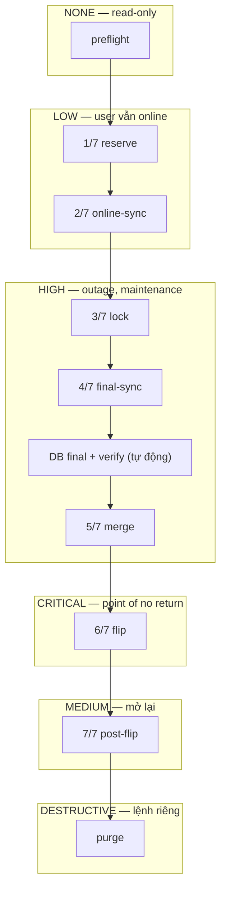

# zmove — Chi tiết từng step move mailbox

> Tài liệu vận hành cho `zmove move`. Mô tả đúng code hiện tại (`engine.py`, `dbmove.py`,
> `blobs.py`, `caches.py`, `topology.py`, `state.py`, `cli.py`).
> Mọi phase đều commit vào SQLite journal **trước** khi làm side-effect tiếp theo → crash lúc
> nào cũng `resume` được từ phase đã commit.

## 1. Tổng quan pipeline

| # | Step (gate `--confirm-steps`) | Phase journal | User thấy gì | Đảo ngược |
|---|---|---|---|---|
| 0 | `new_job` + `preflight` (không hỏi, read-only) | `PLANNED` → `PREFLIGHT_OK` | Không | N/A |
| 1/7 | `reserve` | → `RESERVED` | Không | `abort`: xóa stage + id thừa |
| 2/7 | `online-sync` (presync + prestage) | → `PRESYNC` → `PRESTAGED` | Không (có thể chậm I/O nhẹ) | `abort`: xóa bản đích |
| 3/7 | `lock` | → `LOCKED` | **Outage bắt đầu**: mail/web dừng ở bản cũ | `abort`: mở khóa, bản cũ nguyên vẹn |
| 4/7 | `final-sync` + DB final + verify (verify chạy liền, không hỏi riêng) | → `FINAL_SYNCED` → `DB_FINAL` → `VERIFIED` | Vẫn outage | `abort`: xóa bản đích, mở khóa |
| 5/7 | `merge` | → `MERGED` | Vẫn outage | `abort`: xóa bản live đích |
| 6/7 | `flip` — **POINT OF NO RETURN** | → `FLIPPED` | Client reconnect sang host mới | Chỉ còn `rollback` (có điều kiện) |
| 7/7 | `post-flip` | → `CACHES_PURGED` → `UNLOCKED` → `DONE` | Mở lại trên host mới | `rollback` nếu bản đích chưa đổi |
| — | `purge` (lệnh riêng, sau này) | → `PURGED` | Không | **Không** — xóa bản cũ vĩnh viễn |

Từ chối (`n`/Enter/EOF) tại gate bất kỳ = pause sạch: job dừng ở phase đã commit,
`resume <job>` hỏi lại đúng gate đó, `abort` rollback. Non-TTY/EOF luôn tính là decline,
không bao giờ tự proceed. `resume --yes` bỏ qua confirm cho lần chạy đó.

---

## 2. Step 0 — `new_job` + `preflight` (NONE, read-only, không hỏi)

Hàm: `Engine.new_job()` + `Engine._preflight()` / `Engine.plan()` (`engine.py`).

### 2.1. `new_job`
1. Chặn `src == dst`.
2. `zmprov -l ga <account>` **trên dst** để chốt `account name/id` chuẩn LDAP.
3. `State.create()`: 1 job id ngẫu nhiên, UNIQUE partial “1 job active (`running`/`failed`)
   trên 1 `account_id`” — tương đương `RegisterMailboxMoveOut` của NE.

### 2.2. `preflight` — mọi check đều read-only
1. Cấm `--exclude-tables mail_item/mail_item_dumpster` (rollback + verify phụ thuộc 2 bảng này).
2. `Engine.plan()` chạy và gom `errors[]` / `warnings[]`:
   - `zimbraMailHost == src` (safety check kiểu NE); lệch → error.
   - `version` / `db.version` / `index.version` src == dst (lấy từ `zmcontrol -v` và
     `zimbra.config`); lệch → error.
   - `zmmailboxdctl status` phải chạy trên cả 2 node.
   - Auth thử SOAP admin cả 2 node → fail-fast ngay, không đợi sau presync hàng giờ.
   - `QueryMailboxMove` best-effort cả 2 node: nếu NE báo đang move account này → warning
     (zmove không điều phối với NE, operator tự chọn 1 bên).
   - Src phải có mailbox (`zimbra.mailbox WHERE account_id`); dst chưa có, trừ khi
     `--overwrite` (ghi nhận `stray_dst_mailbox` để xóa ở step reserve).
   - Stale JVM cache: tra journal xem account có từng ở dst sau khi mailboxd dst start
     không → bắt restart mailboxd dst hoặc `--force`.
   - Resolve `blobs / secondary_blobs / search_index` (`include|exclude|config` + attr LDAP
     `zimbraMailboxMoveSkipBlobs/HsmBlobs/SearchIndex`).
   - Blob `exclude` mà không có `shared_volumes` map → error (chỉ được exclude khi dst
     nhìn thấy cùng storage).
   - `shared_volumes` map volume internal → bắt buộc `zimbraConfiguredServerIDForBlobDirEnabled=TRUE`
     trên cả 2 server (không thì dir mailbox 2 server đè nhau trên storage chung); dir src == dir
     đích → error.
   - `db_strategy=delta` bắt buộc `verify=full` (hoặc `--force`): row đổi mà không tăng change
     number chỉ fingerprint full mới bắt được.
   - `map_volumes()`: primary → current primary dst, secondary → current secondary dst
     (không có thì gộp vào primary), index → current index dst; check trùng
     `layout_key` (`file_bits/file_group_bits`), `store_type`, explicit override.
   - Ước lượng dung lượng: `du` từng src dir, so với `df` dst (`need*1.1+1GB`).
   - SSH node-to-node: `ssh -p <node_port> <node_user>@<dst> true` chạy **từ src**
     (rsync chạy trên src, gọi sang dst) → hỏng key/`known_hosts` là error ngay.
   - `DbMove.discover()`: so schema group (`mboxgroup*`) + `zimbra.*` + `zimbra.mailbox`
     (column layout phải giống hệt); bảng lạ ngoài allowlist → error, gợi ý
     `--exclude-tables`.
3. In mọi warning, error nào → `MoveError` liệt kê toàn bộ, job `aborted` (chưa đổi gì).
4. Commit `PREFLIGHT_OK`, lưu: `volume_map`, `copy{blobs,secondary,search_index}`,
   `src_mailbox_id/group/index_volume`, `items/size`, `orig_status`, `orig_transport`,
   `stray_dst_mailbox`.

---

## 3. Step 1/7 — `reserve` (LOW)

Hàm: `Engine._reserve()` (`engine.py`). Gate hỏi:

> `allocate a mailbox id on <dst> + create stage schema zmove_stage_<job>[; DELETE stray
> mailbox <id> on <dst>]`

### Công việc
1. Nếu có stray + `--overwrite`: **verify `account_id` của stray đúng account đang move**
   rồi mới `DELETE` toàn bộ bảng `mailbox_id` (group + `zimbra.*` trong allowlist) +
   `zimbra.mailbox` của stray. Sai chủ → từ chối, không xóa nhầm mailbox người khác.
2. Tái dùng id đã purge: tra bảng `purges(account_id, dst)`; nếu id cũ còn trống thì dùng
   lại (giữ mapping `accountId→mailboxId` cũ trong JVM nhất quán).
3. Ngược lại `reserve_mailbox_id()`: 1 txn `UPDATE zimbra.current_volumes SET
   next_mailbox_id=next_mailbox_id+1` (row-lock serialize với mailboxd) rồi đọc id mới.
   Dry-run dùng id giả `999999`.
4. Commit `RESERVED` (`dst_mailbox_id`, `dst_group=(id-1)%groups+1`).
5. `DbMove.ensure_dst_group_db()` (chạy trong `run()` → `_ctx(prepare=True)`): nếu
   `mboxgroup<dst_group>` chưa có, rỗng hoặc thiếu bảng so với group mẫu (crash giữa chừng) thì
   `CREATE DATABASE IF NOT EXISTS` + clone DDL (`mysqldump --no-data --add-drop-table`) từ 1 group
   mẫu **khác** đã có `mail_item`.
6. `DbMove.create_stage()`: tạo `zmove_stage_<job>`, `CREATE TABLE ... LIKE` từng bảng
   group + `zimbra.*` + `mailbox`, drop unique index để `REPLACE` delta không kẹt.
   Idempotent: resume thấy stage cũ thì chỉ tạo bảng còn thiếu.

### Ảnh hưởng / lỗi
- Ghi duy nhất trên dst: 1 id đã tiêu (không thu hồi), 1 schema stage rỗng.
- Lỗi giữa chừng → `failed` ở `RESERVED`, `abort` drop stage là sạch.

---

## 4. Step 2/7 — `online-sync` (LOW, account vẫn mở)

Hàm: `Engine._online_phase()` (`engine.py`) + `BlobSync` (`blobs.py`) + `DbMove.prestage()`
(`dbmove.py`). Gate hỏi:

> `rsync <N> blob/index dirs + DB prestage (<delta|full>); account stays online`

### 4.1. Presync blob/index (`BlobSync.converge`)
- Mỗi `DirPlan` = 1 dir mailbox đích (`<root>/[serverId/]<bucket>/<dst_id>`) nhận từ 1..n
  dir src (gộp nhiều volume cũ → 1 volume mới). Ghi thẳng dưới `dst_id` đã reserve —
  an toàn vì hàng `zimbra.mailbox` dst chưa `INSERT` nên mailboxd chưa serve dir này.
- `converge(maxSyncs, threshold)`: lặp `sync_once` tới khi 1 pass ≤ `syncFinishThreshold`
  (mặc định 30s) / không còn file mới / đủ `maxSyncs` (mặc định 10).
- Pass online: `ionice -c2 -n7 nice -n 10`, `--bwlimit` (nếu đặt), `-aH --numeric-ids
  --stats --partial --delete`; rsync chạy **trên src**, `ssh` sang dst bằng
  `node_ssh_user/port/options`. Shared storage: chạy local trên dst với `--link-dest`
  (hard-link, không đi dây). External/S3: skip copy, chỉ remap `locator` trong DB.
- Commit `PRESYNC` (`presync_passes`, `last_pass_seconds`).

### 4.2. Prestage DB (`db_strategy=delta`, mặc định)
- `TRUNCATE` bảng delta trong stage (resume-safe, tránh kẹt PK).
- Đọc watermark `W = MAX(mod_metadata, mod_content)` trên `mail_item(+dumpster)` **trước**
  khi dump (change number cấp dưới per-mailbox lock nên txn chưa commit lúc đọc W chắc
  chắn có number > W → delta cuối bắt được).
- `mysqldump --single-transaction --quick --hex-blob --where="mailbox_id=<src>"` →
  `gzip -1` → qua control node → `gzip -dc | mysql <stage>` trên dst. Cả 2 đầu pipe đều
  check exit code.
- Commit `PRESTAGED` (`watermark`, `seconds`, `rows`). `db_strategy=full` thì bỏ qua,
  copy toàn bộ ở pha locked.

### 4.3. Chờ `cutover_window` (nếu đặt)
- Ngoài window `HH:MM-HH:MM` (giờ control node): ngủ theo vòng 30s, `beat` journal,
  check watchdog, rsync giữ ấm mỗi 30 phút; vào window thì `converge` lại 1 lượt.

---

## 5. Step 3/7 — `lock` (HIGH, outage bắt đầu)

Hàm: `Engine._lock()` (`engine.py`). Gate hỏi:

> `set <account> maintenance + LockoutMailbox(start) on <src>; user-visible outage starts`
> (kèm `lock budget left` nếu resume khi đã lock).

### Công việc
1. **Re-check `mailHost == src` ngay trước lock** — LDAP đổi từ lúc preflight → từ chối,
   bắt chạy lại preflight (chống race).
2. Ghi cờ `locking` vào journal **trước** (crash giữa chừng thì abort/unlock vẫn biết phải trả
   source), rồi `zmprov -l ma <account> zimbraAccountStatus maintenance` (chạy trên dst, `-l` vào LDAP)
   + `zmprov flushCache -a account <account>` (rc≠0 → log warning).
3. SOAP `LockoutMailbox(start)` tới **src** (`LockoutMailboxRequest`, curl localhost:7071
   ngay trên src; benign `MAINTENANCE` được bỏ qua), trừ `--skip-lockout`.
4. Commit `LOCKED` (`locked_at`, `lock_deadline = now + max_lock_seconds`, mặc định 900s).
   Watchdog abort+unlock nếu quá hạn trước flip. Từ đây mọi rsync/DB command bị cap timeout
   bằng phần budget còn lại (`min(rsync_timeout|db_timeout, deadline-now)`), nên 1 lệnh dài
   không giữ lock quá `max_lock_seconds`; hết budget giữa lệnh → `LockTimeout` → abort.

---

## 6. Step 4/7 — `final-sync` + DB final + verify (HIGH)

Hàm: `Engine._locked_phase()` (nửa đầu). Gate `4/7` chỉ hỏi 1 lần:

> `final rsync --checksum while locked`

Sau đó **DB final + verify chạy liền tự động**, không hỏi riêng (chúng là kiểm chứng, không
 phải quyết định cắt traffic).

### 6.1. Final rsync → `FINAL_SYNCED`
- `sync_once(final=True)`: full-speed (bỏ ionice/bwlimit), thêm `--checksum` so nội dung
  thay vì chỉ size/mtime; src dir không còn (mailbox rỗng) thì dọn dir đích tránh sót rác.

### 6.2. DB final → `DB_FINAL` (`DbMove.final`, chạy dưới lock)
- `delta`: copy `mailbox_id=<src> AND (mod_metadata>W OR mod_content>W)` bằng
  `mysqldump --replace`; dựng bảng `_ids_<t>` chứa id hiện tại ở src, `DELETE` khỏi stage
  mọi row không còn ở src (bắt hard-delete/purge); copy full các bảng group còn lại +
  `zimbra.*` + hàng `zimbra.mailbox`.
- `full`: `TRUNCATE` + copy toàn bộ `mailbox_id=<src>`.

### 6.3. Verify → `VERIFIED` (`DbMove.compare` + inventory)
- Từng bảng: fingerprint `COUNT + BIT_XOR(64-bit đầu MD5(row))` so **src vs stage**.
  Lệch + mode delta → tự `refull_delta_tables()` 1 lần rồi so lại; còn lệch →
  `VerifyError`, dừng (chưa merge nên bản live dst chưa động).
- Blob/index: so `(số file, tổng bytes)` src vs dst từng `DirPlan` (bỏ qua external).
  Lệch → `VerifyError`.
- `verify=count` chỉ so count; `verify=none`/dry-run bỏ qua (khuyến nghị giữ `full`).

---

## 7. Step 5/7 — `merge` (HIGH)

Hàm: `Engine._locked_phase()` (nửa sau). Gate hỏi:

> `insert stage into live tables on <dst> as mailbox <dst_id>`

### Công việc
1. Resume sau merge đã commit: nếu `dst_id` đã tồn tại trong `zimbra.mailbox` thì
   verify `account_id` rồi `DELETE` bản live dở trước khi merge lại.
2. `DbMove.merge()`: **1 txn** `SET FOREIGN_KEY_CHECKS=0`:
   `INSERT zimbra.mailbox SELECT` từ stage (override `group_id`, `index_volume_id`,
   `itemcache_checkpoint+1`) → `INSERT` các `zimbra.*` → `INSERT` từng bảng group với
   `mailbox_id=<dst_id>` + `locator = CASE WHEN '<src_vol>' THEN '<dst_vol>' ...` →
   `DELETE zimbra.deleted_account WHERE email` → `COMMIT`.
3. So `src_mapped` (src áp cùng CASE locator) vs `live` dst: lệch → `DELETE` bản live vừa
   merge + `VerifyError` (tự rollback merge).
4. Check watchdog, commit `MERGED` + `merged_max_change = live_max_change()` trên dst
   (mốc để `rollback` chứng minh bản đích chưa bị sửa sau cutover).

---

## 8. Step 6/7 — `flip` (CRITICAL, point of no return)

Hàm: `Engine._flip()` (`engine.py`). Gate hỏi:

> `set zimbraMailHost=<dst> -- POINT OF NO RETURN`

### Công việc
1. Rewrite transport: chỉ đổi host khi là `lmtp:host:port`; `smtp:/hold/error/VIP` hoặc
   rỗng → giữ nguyên/giá trị mặc định + warning (không bao giờ viết bậy routing custom).
2. `zmprov -l ma <account> zimbraMailHost <dst> zimbraMailTransport <transport>`.
3. Commit `FLIPPED` (`flipped_at`, `new_transport`). Từ đây `abort` bị chặn, chỉ còn
   `rollback`/move ngược; bản src giữ nguyên để rollback/purge sau.

---

## 9. Step 7/7 — `post-flip` (MEDIUM)

Hàm: `Engine._post_flip()` (`engine.py`) + `caches.py`. Gate hỏi:

> `purge caches, restore account status, drop stage`

### Công việc
1. `CACHES_PURGED`: `flushCache -a account`, `zmproxypurge -a` (route nginx trong
   memcached), xóa key account-scoped `zmFldrsTags:{id}`, `zmCalsList:{id}` trên **mọi**
   memcached trong `zimbraMemcachedClientServerList` (fallback `gas memcached`); bỏ qua
   2 việc sau nếu `--skip-memcache-purge`. Lỗi từng lệnh → log warning, không fail job.
2. `UNLOCKED`: trả `zimbraAccountStatus = orig_status` (giữ `closed/locked` gốc, không ép
   `active`) + `flushCache`; tính `lock_seconds = now - locked_at`. **Bản src cố ý giữ
   lockout maintenance** tới khi purge/rollback để JVM src không đụng bản cũ.
3. `DONE`: `zmprov rim start` nếu bỏ index hoặc `--reindex-after`; `postqueue -f` trên
   `mta_hosts` (fallback `gas mta`), batch nên `--no-flush-mta` rồi flush 1 lần cuối;
   drop stage (trừ `--keep-stage`); `status=done` (+ cờ `dry_run` nếu dry-run); ghi metrics
   Prometheus textfile (nếu đặt) + prune event > 30 ngày.

---

## 10. Sau move — `purge` (DESTRUCTIVE, lệnh riêng)

Hàm: `Engine.purge()` — `zmove purge ACCOUNT --server <src>` (`cli.py`, `engine.py`).

1. Chỉ purge job `phase DONE` **và** `status=done` (job đã rollback bị loại), từ chối job
   `dry_run`, từ chối khi `mailHost` đã quay về src hoặc account còn 1 move mới hơn chưa xong.
2. Verify đúng `src_mailbox_id` còn trên src (sai → nghi đã purge, dừng).
3. `DELETE` DB src (group + `zimbra.*` allowlist + `zimbra.mailbox`) trong 1 txn; `rm -rf
   --one-file-system` từng blob/index dir src (trừ `--keep-blobs`; shared storage thì chỉ
   unlink hard-link, an toàn).
4. Ghi `purges(account_id, src, mailbox_id)` để move sau tái dùng id; commit `PURGED`.

---

## 11. Rẽ nhánh: decline / resume / abort / rollback / unlock / gc

| Tình huống | Hành vi |
|---|---|
| Decline tại gate | `StepDeclined`: `aborted` nếu `< RESERVED`, `failed` nếu sau; log `PAUSED` + nhắc `resume/abort`; đang giữ lock thì warn rõ `still LOCKED` |
| `resume <job>` | Chạy tiếp từ phase đã commit. Từ chối job đã rollback/purge/done, job `aborted` sau `FLIPPED`, và job đang được process khác chạy (owner còn sống hoặc heartbeat < 120s; heartbeat thread beat mỗi 30s) trừ `--force`. Resume khi locked → `_relock`: check lại `mailHost`, set lại `maintenance`, re-`lockout(start)`, cấp lại watchdog, hạ `>LOCKED` về `LOCKED` để sync/verify lại từ đầu (có lấy semaphore cutover của batch) |
| `resume --yes` | Tắt `confirm_steps` cho lần chạy đó |
| `abort` (chỉ `< FLIPPED`) | Xóa live dst + blob dirs dst + stage — **trừ khi** id đích đã thuộc job khác hoặc account đang home ở dst. **Luôn** `lockout(end)` + trả `orig_status` nếu job từng lock (kể cả khi không dựng được context vì dst sập). Không trả được source → job giữ `failed` + cờ `locking`, báo lỗi. Thành công → `aborted`, phase hạ về `RESERVED`, xóa `watermark/lock_deadline/merged_*` để resume copy lại từ online phase |
| `rollback` (sau `FLIPPED`, trước `PURGED`) | Từ chối job dry-run/đã rollback; maintenance dst, so `[max change, số row]` live với lúc merge (lệch → bắt `--force` hoặc move ngược); trả `mailHost/Transport` về src (transport rỗng → xóa attr), purge route + memcached, `lockout(end)` src, trả status, xóa live dst + blob dirs; ghi `rolled_back_at` (move lại sang dst phải restart mailboxd dst trước) |
| `unlock ACCOUNT -s <server>` | Khôi phục sự cố kẹt lock: job active `< FLIPPED` → `abort` đầy đủ (dọn cả bản đã merge); rồi trả `orig_status` của job gần nhất (không ép `active`, kể cả sau flip), `flushCache`, `lockout(end)` trên `mailHost` hiện tại |
| `gc` | Job `failed` (chưa lock) → `abort`; job `aborted` → dọn stage + blob dirs đích (chỉ khi id đích không còn được dùng và không thuộc job khác), đánh dấu `gc_at` để lần sau bỏ qua; bỏ qua `≥ FLIPPED` và `failed` đang locked |

## 12. Tham chiếu nhanh

- State machine: `Engine.run()` — `engine.py:run/_preflight/_reserve/_online_phase/_lock/
  _locked_phase/_flip/_post_flip/abort/rollback/purge/unlock`
- Gate xác nhận: `CONFIRM_STEPS`, `_stdin_confirm()`, `Engine._confirm()`, `StepDeclined`
- DB: `DbMove.discover/prestage/final/compare/merge/delete_live_dst/live_max_change`,
  `reserve_mailbox_id()` — `dbmove.py`; SQL helpers — `db.py`
- Blob: `BlobSync.converge/sync_once/inventory` — `blobs.py`; volume map —
  `paths.py:map_volumes/mailbox_dir/locator_case_sql/replace_host_in_transport`
- Cache/MTA: `caches.py:flush_account_cache/purge_proxy_routes/delete_memcached_keys/
  flush_mta_queues`
- Discovery: `topology.py:server_info/account_info/mailbox_row/memcached_servers/mta_servers`
- Journal: `state.py:Phase/State/Job` (`PLANNED→PREFLIGHT_OK→RESERVED→PRESYNC→PRESTAGED→
  LOCKED→FINAL_SYNCED→DB_FINAL→VERIFIED→MERGED→FLIPPED→CACHES_PURGED→UNLOCKED→DONE→PURGED`)
